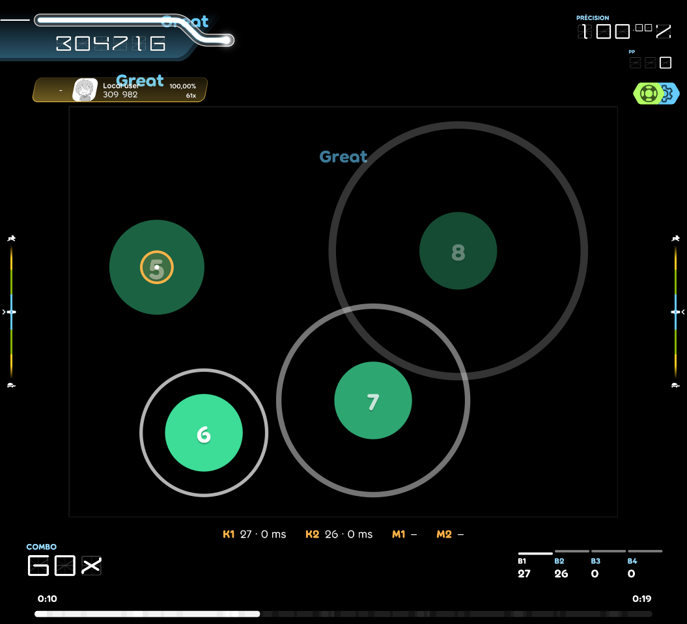
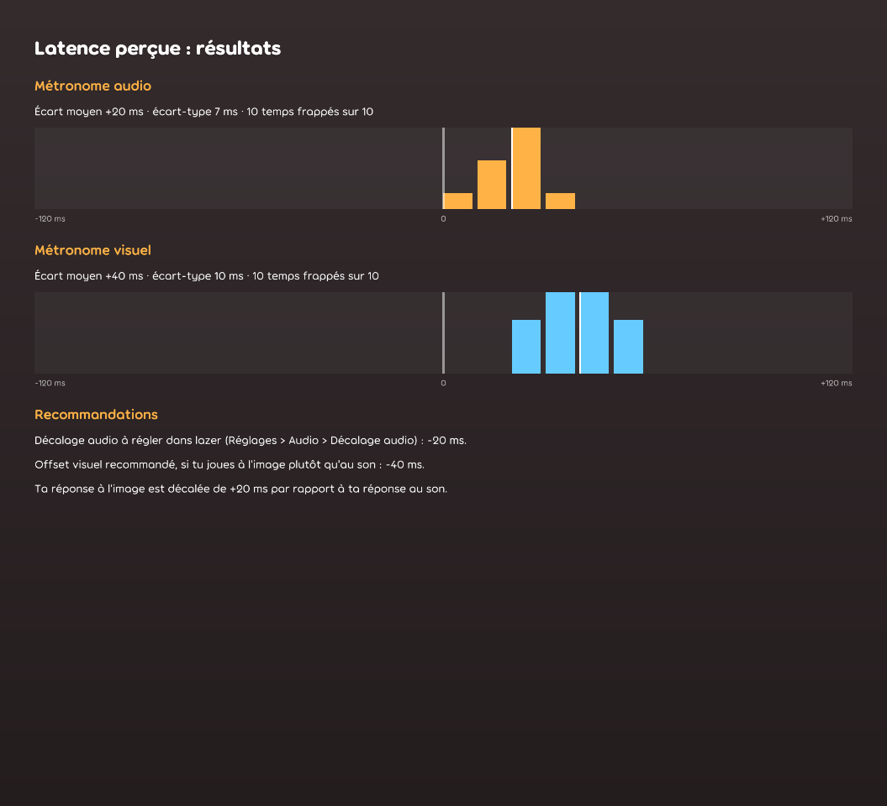
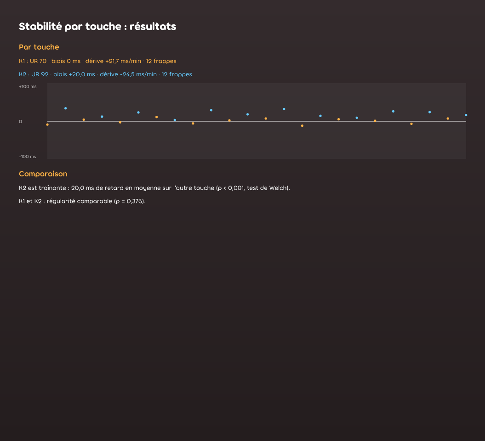
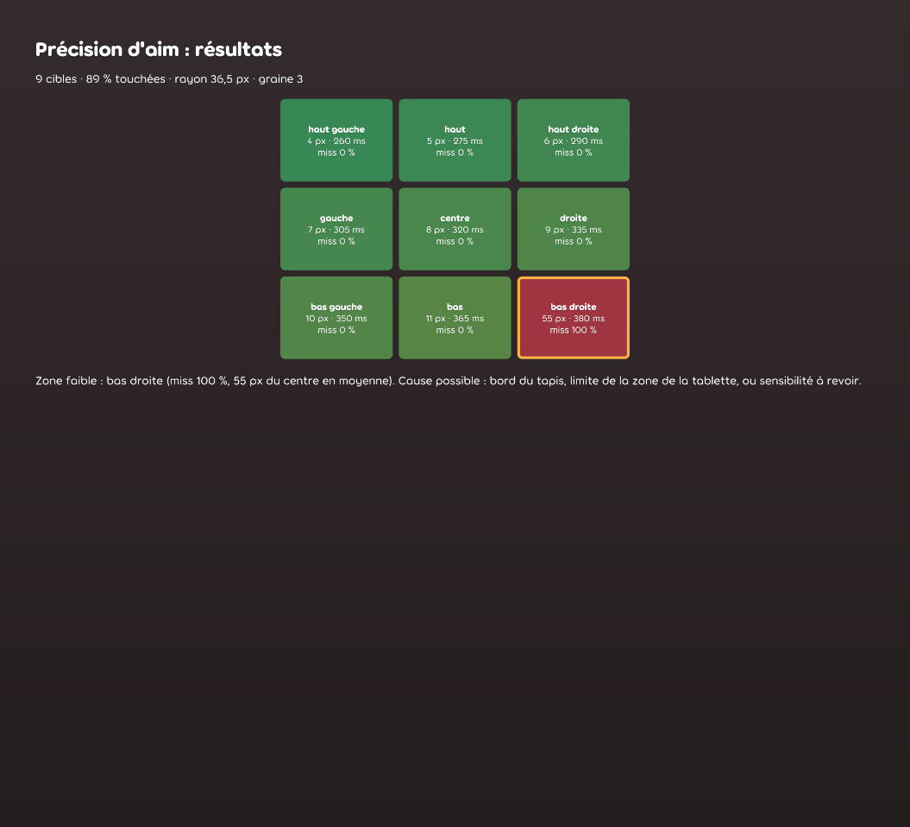
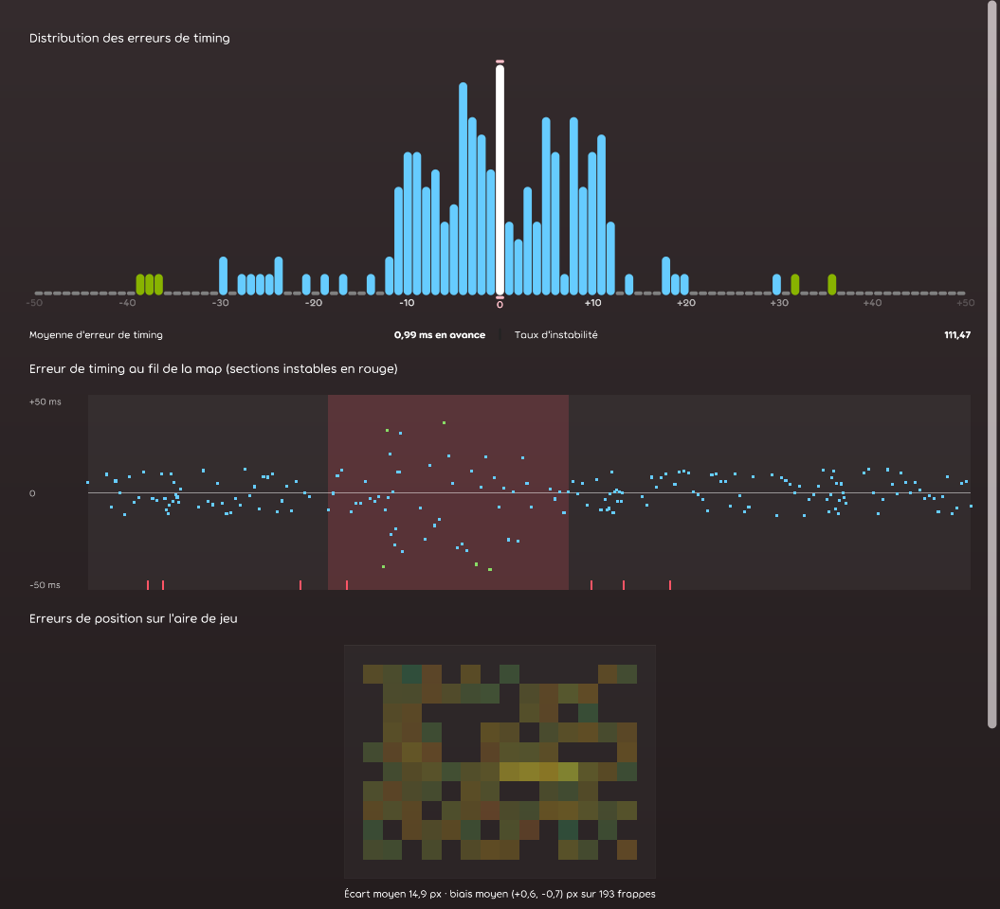
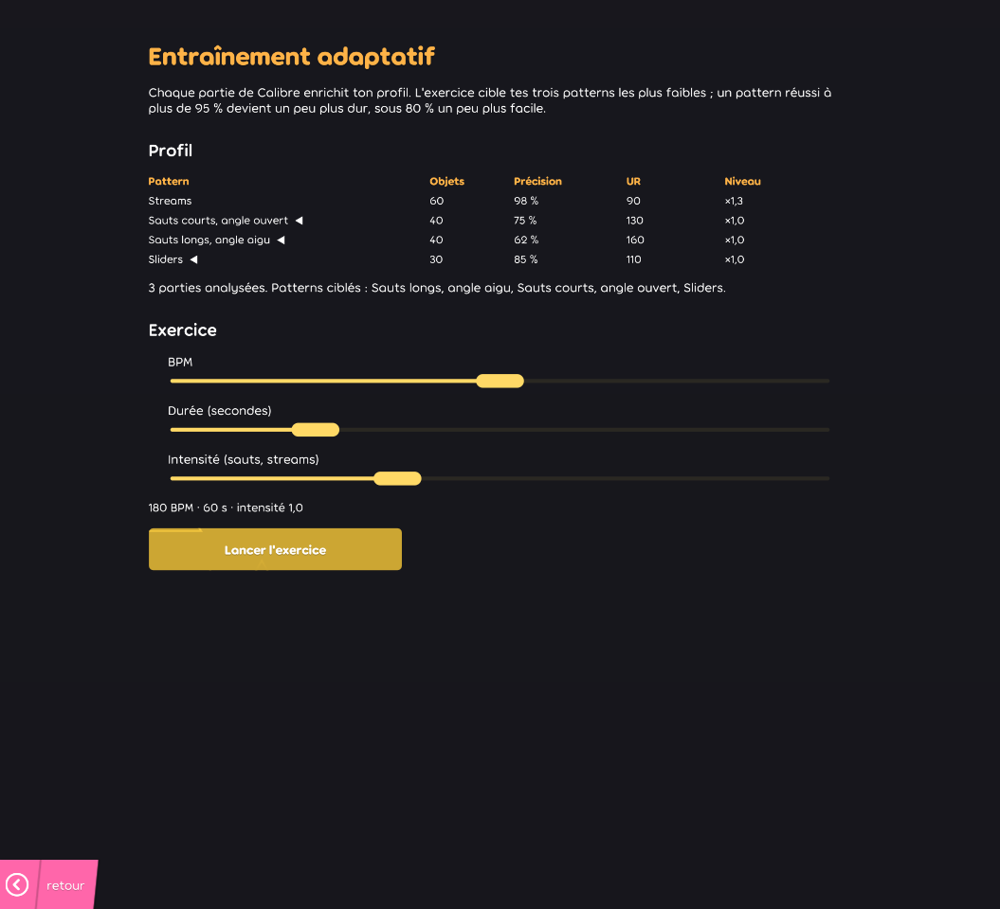

# Calibre

Ruleset d'entraînement et d'analyse pour **osu!lazer**, orienté aim et tap. Calibre joue les beatmaps osu!standard
existantes et ajoute trois modules : il **diagnostique** le matériel du joueur, **analyse** chaque partie et génère des
**exercices** ciblés sur ses points faibles.



## En bref

- **Un vrai mode de jeu.** Cercles, sliders et spinners suivent les règles d'osu!standard (fenêtres de jugement, rayon,
  préempt, suivi des sliders, tours des spinners). Un UR mesuré dans Calibre se compare donc à celui du jeu.
- **Diagnostic des périphériques.** Il mesure la latence perçue, la stabilité de chaque touche et la précision d'aim
  par zone de l'écran. Les résultats s'exportent en JSON horodaté.
- **Analyse de partie.** L'écran de résultats affiche la timeline des erreurs avec ses passages instables, une heatmap
  des erreurs de position et un classement par type de pattern.
- **Entraînement adaptatif.** Un profil local cumule les parties. Un générateur déterministe crée des exercices sur
  les patterns les plus faibles, et leur difficulté suit la progression du joueur.
- **182 tests**, logique NUnit et scènes visuelles, exécutés en CI sur Windows à chaque push.

## Les trois modules

### Diagnostic des périphériques

Dans lazer : **Réglages > Calibre > Diagnostic des périphériques**. Trois tests se jouent avec les touches de Calibre.

| Test | Déroulé | Mesures |
|---|---|---|
| Latence perçue | Frappe sur un métronome audio (100 BPM), puis sur un métronome visuel seul, son coupé | Écart moyen et écart-type de chaque phase, offsets audio et visuel recommandés |
| Stabilité par touche | Frappe en alternance K1/K2 (ou M1/M2) sur un métronome rapide, comme dans un stream | UR, biais (avance ou retard) et dérive de chaque touche, touche « traînante » ou moins régulière |
| Précision d'aim | 45 cibles sur une grille 3x3 de l'aire de jeu, au même cadrage qu'en partie | Distance au centre, temps de réaction et taux de miss par zone, zone faible |

<p>
  
  
  
</p>

- **Touche traînante.** Un test t de Welch compare les moyennes de deux touches jumelles (p < 0,05). Il faut aussi un
  décalage d'au moins 3 ms, sinon le grand nombre de frappes ferait signaler une différence infime.
- **Touche moins régulière.** Un test F compare les variances, et l'UR doit être au moins 1,2 fois plus élevé.
- **Dérive.** C'est la pente de la régression linéaire de l'écart en fonction du temps, en ms par minute.
- **Comparaison de matériel.** Les cibles d'aim sont générées à graine fixe : deux périphériques testés voient la même
  séquence. Le bouton « Exporter en JSON » écrit `calibre/diagnostics/calibre-diagnostic-<date>.json` dans le dossier
  de données de lazer. Le fichier contient un libellé libre, les résultats et les données brutes.

### Analyse de partie

Après chaque partie, l'écran de résultats de lazer affiche les panneaux de Calibre. Ils sont calculés à partir des
`HitEvents` du score.



- **Distribution des erreurs de timing, erreur moyenne et UR** : les composants de lazer, réutilisés tels quels.
- **Erreur de timing au fil de la map** : chaque frappe est placée dans le temps, et les misses sont marqués en bas.
  Les sections instables sont des fenêtres de 16 frappes dont l'UR atteint 1,25 fois celui de la partie, avec au moins
  10 points de plus.
- **Heatmap des erreurs de position** : une grille 16x12 de l'aire de jeu, teintée selon l'écart moyen entre le curseur
  et le centre des cibles. Le panneau donne aussi le biais moyen de visée.
- **Classement par pattern** : précision, UR et écart moyen par catégorie. Une note se classe d'après le mouvement qui
  y mène depuis l'objet précédent :
  - **isolée** au-delà de 500 ms ;
  - **stream** sous 125 ms et 1,5 diamètre d'espacement ;
  - **saut** sinon : **long** à partir de 3 diamètres, **aigu** si l'angle au sommet est sous 90°.
  - Les sliders forment leur propre catégorie.

### Entraînement adaptatif

Dans lazer : **Réglages > Calibre > Entraînement adaptatif**.



- **Profil.** Chaque partie de Calibre terminée ajoute son bilan par pattern à `calibre/profile.json`. Les replays,
  l'autoplay et les parties ratées sont écartés : après un échec, lazer n'enregistre plus de `HitEvents`.
- **Exercice.** L'écran cible les trois patterns de plus basse précision parmi ceux joués au moins 20 fois. On règle le
  BPM (120 à 240), la durée (30 à 180 s) et l'intensité. L'exercice se joue comme une partie normale, sur un métronome
  généré en code, et passe par l'écran de résultats de l'analyse.
- **Difficulté progressive.** Chaque pattern a un niveau, de ×0,5 à ×2, qui allonge ses streams et ses sauts. Après une
  partie, il gagne 0,1 si la précision atteint 95 %, et perd 0,1 sous 80 %.
- **Mod No Fail.** Il permet de finir un exercice difficile, et donc de l'enregistrer.

## Choix techniques

### Pourquoi un ruleset osu!lazer

- **Les beatmaps et les joueurs existent déjà.** Un ruleset lit toute la bibliothèque osu!standard du joueur, sans format
  propre ni éditeur à écrire.
- **osu-framework est fait pour le temps réel.** L'horloge de jeu suit la piste audio, l'entrée, la mise à jour et le
  dessin tournent sur des threads séparés, et le rendu passe par Direct3D, Vulkan ou OpenGL. Refaire tout cela pour un
  outil de mesure introduirait plus de latence que ce qu'on veut mesurer.
- **lazer est extensible aux bons endroits.** Le ruleset fournit ses panneaux à l'écran de résultats, ses réglages et ses
  mods, et réutilise les processeurs de score et de vie, le HUD, le système de replays et les composants statistiques.
- **Le framework de test de lazer est disponible.** Les scènes visuelles tournent sans fenêtre en CI, avec la même
  infrastructure que le dépôt officiel.

### Latence et temps réel

- **Horloge de référence.** En partie, tout le timing vient de l'horloge du framework, calée sur la piste audio, et jamais
  du temps de frame. Le métronome du diagnostic est une piste WAV générée en mémoire, avec chaque clic écrit à
  l'échantillon exact de son temps. Sa position de lecture sert d'horloge.
- **Datation des frappes.** Une frappe est datée à sa réception, et non à l'image suivante.
- **Zéro allocation en jeu.** Les drawables et les libellés de jugement sont poolés. Le jugement passe par des lambdas
  statiques avec état en paramètre, sans fermeture. Le suivi des sliders et la rotation des spinners n'allouent rien.
- **Analyse hors du thread de jeu.** lazer appelle `CreateStatisticsForScore` dans une tâche de fond, et toute l'analyse
  se fait là. Le profil est mis à jour en tâche de fond après la partie, à partir d'une copie des `HitEvents`.

### Mesure

- **Grandeurs d'osu!standard.** L'UR suit la définition de lazer, 10 × l'écart-type des écarts, avec temps et écarts
  divisés par la vitesse de jeu.
- **Quatre entrées distinctes.** K1, K2, M1 et M2 restent séparées, au lieu d'être fusionnées en « gauche / droite », et
  sont enregistrées avec chaque frappe.
- **Statistiques sans dépendance.** Les lois de Student et de Fisher sont calculées en code (fonction bêta incomplète),
  puis vérifiées contre leurs tables.
- **Profil exact.** Il garde des sommes plutôt que des moyennes : l'UR de toutes les parties réunies se recalcule
  exactement. Son écriture est atomique, et un profil illisible est mis de côté au lieu d'être écrasé.

### Générateur d'exercices

- **Déterminisme.** Un seul `Random`, initialisé par la graine : à graine égale, le même exercice. La graine est affichée.
- **Cohérence avec l'analyse.** Les patterns générés suivent les seuils du classement. Les tests vérifient que l'analyse
  d'un exercice parfait retrouve le pattern entraîné dans au moins 90 % des enchaînements, pour chaque type et aux deux
  BPM extrêmes, et qu'un exercice se termine en autoplay à 100 %.
- **Sauts dans l'aire de jeu.** Un saut ouvert arrivé de face contre un bord ne pourrait repartir qu'en demi-tour, ce
  qui en ferait un saut aigu. Le générateur choisit donc chaque rotation en anticipant jusqu'à trois sauts.

### Contraintes découvertes

Ces contraintes ont été établies par analyse statique des binaires de lazer installés, avec
[REA](https://github.com/morluto/rea), puis vérifiées en chargeant la DLL contre ces mêmes binaires.

- **Nom de la DLL.** lazer ne charge que les fichiers `osu.Game.Rulesets.*.dll`. Sa version distribuée refuse aussi
  ceux dont le nom contient `plugin`, `loader`, `trainer`, `inject`, `mosu`… Cette vérification est absente du source
  public. C'est pourquoi le module d'entraînement s'appelle `Training` et non `Trainer`.
- **Replays non persistés.** lazer n'écrit de fichier `.osr` que pour les quatre rulesets officiels. Un replay Calibre
  vit en mémoire jusqu'à l'écran de résultats, et les analyses s'exécutent à ce moment-là.
- **Version ciblée.** Le NuGet `ppy.osu.Game 2026.1026.0` suit une pré-release, et la dernière version stable de lazer
  (2026.1005.0) n'a pas de paquet NuGet. Toutes les références de la DLL ont été vérifiées comme présentes dans lazer
  2026.1005.0, et la routine de compatibilité de lazer passe.

## Compiler, tester, installer

Prérequis : Windows 10/11, [.NET SDK 10](https://dotnet.microsoft.com/download/dotnet/10.0)
(`winget install Microsoft.DotNet.SDK.10`) et osu!lazer **2026.1005.0** ou plus récent.

```bash
dotnet build
dotnet test
```

`dotnet test` exécute la logique NUnit et les scènes visuelles sans fenêtre.

Pour jouer dans lazer :

```powershell
powershell -ExecutionPolicy Bypass -File scripts\install.ps1
```

Le script compile en Release et copie `osu.Game.Rulesets.Calibre.dll` dans **`%APPDATA%\osu\rulesets\`**. Il faut
ensuite redémarrer lazer : Calibre apparaît dans la liste des modes de jeu.

Outils de développement :

- `dotnet run --project osu.Game.Rulesets.Calibre.Tests` ouvre le navigateur de scènes visuelles. Son stockage est
  dédié (`%APPDATA%\calibre-visual-tests`), séparé des données de lazer.
- `dotnet run --project osu.Game.Rulesets.Calibre.Tests -- --screenshots docs/screenshots` régénère les captures de ce
  README. Elles viennent des scènes visuelles, sur des parties simulées : autoplay pour le jeu, frappes scriptées pour
  le diagnostic, profil d'exemple pour l'entraînement.

## Organisation du code

| Dossier | Contenu |
|---|---|
| `Beatmaps`, `Objects`, `Judgements`, `Scoring`, `Replays`, `Mods` | Le mode de jeu : conversion, objets, jugement, score et vie, replays et autoplay |
| `UI` | Aire de jeu, curseur, panneau d'écart par touche, réglages du ruleset |
| `Diagnostics` | Module Diagnostic : statistiques (`Logic`), métronome (`Audio`), export JSON, écrans et graphiques |
| `Analysis`, `Statistics` | Module Analyse : appariement des frappes, classement, sections instables, heatmap et panneaux de résultats |
| `Training` | Module Entraînement : profil, stockage, générateur, écran et partie d'exercice |

Les tests suivent la même structure : `Logic` pour la logique pure (NUnit), `Visual` pour une scène par écran ou
composant majeur.

## Limites connues

- Pas de *stacking* des objets superposés, ni de corps de slider qui se dessine progressivement.
- Le suivi d'un slider accepte toute touche maintenue, même enfoncée avant le slider.
- En replay, revenir en arrière pendant un spinner ne recalcule pas sa rotation.
- Ni bonus de spinner ni son de glissement sur les sliders.
- osu-framework ne date pas les entrées au niveau matériel. Elles sont relevées à 1000 Hz puis traitées sur le thread
  de mise à jour, où Calibre les date : la précision est de l'ordre de la milliseconde, comme dans lazer.
- L'éclair du métronome visuel apparaît à l'image qui suit le temps : la fréquence de l'écran fait partie de la latence
  visuelle mesurée.
- Un test de stabilité mesure les touches utilisées pendant ce test. Tester la souris après le clavier remplace le
  résultat précédent : il faut exporter entre les deux. La comparaison de deux exports se fait hors du jeu.
- Les seuils de classement des patterns sont fixes et ne s'adaptent pas au BPM de la map.
- Sans fichier `.osr` pour un ruleset custom, l'analyse n'est disponible que juste après la partie, ou pour un replay
  encore en mémoire.
- Les scores des exercices ne sont pas enregistrés dans lazer : leur beatmap, générée à la volée, n'existe pas dans sa
  base. Ils comptent seulement pour le profil.
- Les sauts longs ouverts tiennent difficilement dans l'aire de jeu : leurs blocs ne comptent que trois sauts, à
  3,8 diamètres au plus.

## Historique

Le projet a été mené en six jalons, chacun livré par une pull request avec une CI verte.

| Jalon | Contenu |
|---|---|
| J1 | Ruleset minimal jouable : conversion, cercles, jugement, replays, autoplay |
| J2 | Sliders, spinners, score, vie et HUD |
| J3 | Module Diagnostic |
| J4 | Module Analyse |
| J5 | Module Entraînement adaptatif |
| J6 | Finitions, captures générées, README final |

## Licence et mentions

Calibre est distribué sous licence MIT (voir [LICENCE](LICENCE)). Une partie du code est adaptée
d'[osu!](https://github.com/ppy/osu) (© ppy Pty Ltd, licence MIT) ; les fichiers concernés l'indiquent en en-tête.
Calibre s'appuie sur [osu-framework](https://github.com/ppy/osu-framework) et le paquet `ppy.osu.Game`, tous deux
sous licence MIT.

Calibre est un projet indépendant, **sans affiliation avec ppy Pty Ltd**. Il n'utilise ni la marque osu!, ni son logo,
ni les ressources graphiques d'`osu-resources` : tous les visuels sont dessinés en code.
